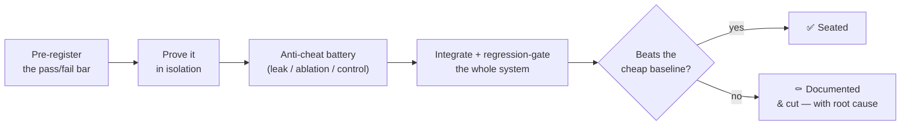
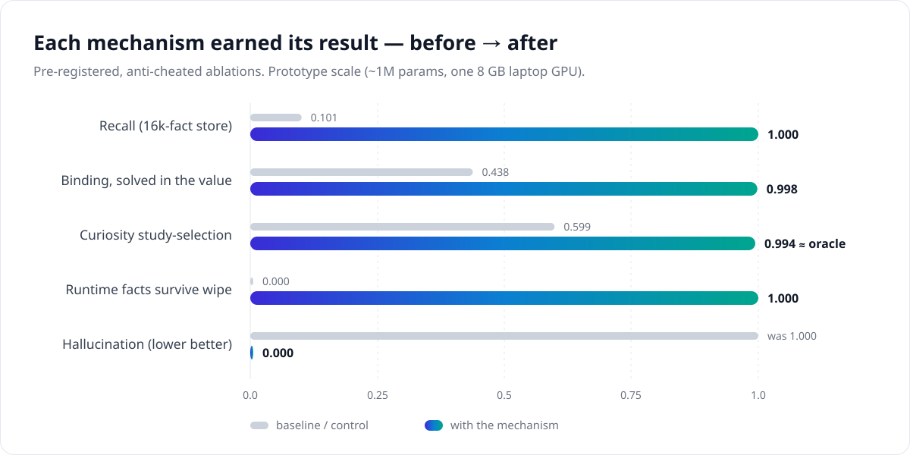
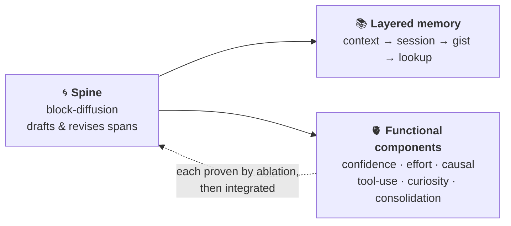

# 🐍 Ouroboros

**A new composite language-model architecture — built by one person on a single 8&nbsp;GB laptop, one mechanism at a time, where every design choice had to survive a pre-registered ablation and every failure is kept on the record.**

> [!IMPORTANT]
> **This repository is a public research log — not the source code.**
> The implementation, model checkpoints, training recipes, and detailed roadmap are held in a **private repository** and are not included here. What you're reading documents *what was built, how it was tested, and what the measurements showed* — including the many things that did not work. It is shared so the **method and the evidence** can be evaluated. The code is available to serious partners under separate arrangement.

---

## What this is

Most language models share one blueprint: read left-to-right, predict one token at a time, never revise, and stop learning when training ends. **Ouroboros is a different architecture.** It began from a *block-diffusion* foundation — a model that drafts and revises whole spans rather than emitting one token at a time — and is being extended into a **composite design that absorbs the strongest, individually-proven ideas from across the architecture landscape** (state-space memory efficiency, adaptive-depth reasoning, retrieval-augmented recall, continual-learning consolidation), each folded in only after it earns its place on measured evidence.

The result is a compact model designed to:

| | Capability | What it means |
|---|---|---|
| 🌀 | **Draft & revise** | writes a whole reply at once, then refines it — a bidirectional design that *can* revise an earlier span rather than only appending, which a left-to-right model structurally cannot (demonstrated at prototype scale; carrying it to a larger base is in-progress work) |
| 📚 | **Remember in layers** | short-term context → per-conversation memory → compressed gist → a large lookup store |
| 🚿 | **Forget on purpose** | a learned gate clears stale session state on reset while keeping fresh state intact |
| 🎓 | **Know when it doesn't know** | one calibrated confidence signal drives abstention — it says "I don't know" instead of guessing |
| 💪 | **Scale effort to difficulty** | spends more compute on harder problems, automatically |
| 😴 | **Consolidate offline** | facts learned quickly at runtime are carried into the slow weights via a replay step |

---

## Why this approach

**The goal.** Build a small model that punches far above its parameter count — one that reasons, follows instructions, uses tools, and keeps learning — by giving it *capabilities the standard recipe can't*, rather than by simply making it bigger. The bet is that careful architecture and a rigorous, one-mechanism-at-a-time build can close much of the gap that the field currently closes only with scale.

**Why a block-diffusion foundation.** A standard autoregressive model commits to each token left-to-right and can never revise it. A block-diffusion model instead drafts a whole span and refines it, with attention running in both directions — which unlocks things an autoregressive model *structurally cannot do*:

- **It can revise an earlier part of its own answer** after seeing what came later — genuine self-revision rather than re-generation (shown at prototype scale; making it hold on a larger base is exactly the kind of open question tracked below).
- **It can decide its own order of work** — commit the parts it's confident about first, resolve the hard parts with more passes.
- **It exposes a richer confidence signal** (from the refinement trajectory, not a single guess), which the calibrated "know when you don't know" component builds on.

Autoregressive left-to-right generation is a *special case* of this more general process — so the foundation gives up nothing the standard approach has, while adding a headroom it lacks.

**Why not stop there.** Block-diffusion is the starting substrate, not the destination. Other architecture families each have a genuinely proven strength — efficient long-range memory, adaptive reasoning depth, retrieval-augmented recall. Rather than pick one, Ouroboros **absorbs each proven mechanism onto the foundation**, but only after it earns its place under the same falsifiable test as everything else. The aim is a single composite architecture that combines these strengths instead of trading between them.

---

## The method — this is the point

The distinguishing feature of this work is not any one mechanism. It's the **discipline that decides what survives.** Every component follows the same rules:

1. **Earn your place or die.** The bar is written down *before* the run. Fail → documented and cut.
2. **Anti-cheat everything.** Surface-leak probes, token ablations, key-only probes. A result that can't survive its anti-cheat is void.
3. **One primitive at a time.** Prove solo → integrate → regression-gate → only then add the next.
4. **Non-saturating metrics.** Accuracy saturates at toy scale, so components are judged on calibration, selective prediction, hallucination rate, and recovery speed.
5. **The honesty rule.** No claim without the run output. Confounds get forensics, not hand-waving.

**The lesson that reshaped everything — the cheap-baseline gate:** *name the trivial baseline that could pass your bar without the mechanism, and show your design beats it.* Applied consistently, it revealed that most apparent "failures" were measurement artifacts — and, just as often, that an apparent *win* collapsed once the right baseline was named:

- A component that **beat its bar by a wide margin** was caught as **noise between two models that had never learned the task.**
- A variance-reduction method looked like a **30× win**; a crash forced an accidental re-run of the identical config, and one seed swung from success to total collapse. The "30×" was a single knife-edge seed. *Measure a stability method with a statistic that would move if it worked — not a mean over three seeds.*
- A memory mechanism the literature said *"don't bother"* worked fine — but the real blocker was a baseline nobody named: an exact-match lookup already inside the model, scoring perfectly. *Enumerate every cheap baseline, not just the obvious one.*

The failures are the most instructive part of this repository, and they're all on the record with root causes and comeback paths.

---

## Selected measured results

> **Scale note:** the chart and the first table below are **prototype-scale** results (~1M-param models, one 8&nbsp;GB laptop GPU). The final row-set is separately labeled where it applies to a larger base. Every number is the output of a pre-registered, anti-cheated ablation.

<picture>
  <source media="(prefers-color-scheme: dark)" srcset="assets/lifts-dark.svg">
  
</picture>

The story these show is not a wall of perfect scores — it's the **delta**: each mechanism moving its metric decisively past the baseline that would pass *without* it.

**Prototype scale (~1M params):**

| Result | Baseline / control | With the mechanism |
|---|---|---|
| Runtime-learned facts survive a memory wipe (via "sleep" consolidation) | 0.000 | **1.000** |
| Recall of facts beyond parametric capacity (16k-fact store) | 0.101 | **1.000** (fabrication 0.000 off-coverage) |
| A binding problem, solved in the memory value | 0.438 | **0.998** (at ⅓ the storage) |
| Curiosity ≈ oracle study-selection under a fixed budget | 0.599 | **0.994** (oracle 0.995) |
| Tool-use reads the world, not memory | — | corrupt the tool output → the model follows it, **1.000** |
| Effort dial: match max-compute accuracy for less compute | full compute | **−61% compute**, equal accuracy |
| Hallucination on unanswerable questions (held across 15 integration steps) | — | **0.000** (coverage 1.000) |

**Larger-base result (a stronger 1.5B-class open model):**

| Result | Measured |
|---|---|
| A knowledge-boundary detector — in-flight, no extra training | **AUROC 1.00** on a curated known-vs-unknown evaluation set, separating what the model knows from what it doesn't |

*(Honest scope: this was measured on a controlled evaluation set; a production-grade form that runs against an arbitrary live datastore is in-progress work, not a shipped result.)*

---

## What's proven, what's open, and what failed

An architecture you can trust is one that draws these lines clearly. The full picture — not just the wins:

### ✅ Proven (at prototype scale)

The results above — each a pre-registered, anti-cheated ablation on ~1M-param models. These are real and reproducible, at that scale.

### 🔬 Proven, but not yet at scale — the honest open questions

These are the claims still to be earned. Naming them is the point:

- **Memory at large scale is unmeasured.** The retrieval store holds exact recall up to ~170k keys today. The larger tiers (1M+) that a real "long memory" claim depends on are **pre-registered but not yet run** — until they are, the honest ceiling is 170k, not infinity.
- **A stronger base absorbs much of the prototype roster.** Porting the toy-scale components onto a capable 1.5B-class model showed that a strong base already does several of them natively — so the *added* value at that scale is smaller than the prototype work alone would suggest. This is a genuine finding that cuts against the project, and it reshaped the plan (toward training-time integration, not decode-time bolt-ons).
- **Single-pass long-form has a measured wall.** In one uninterrupted pass the model tops out around a few hundred words before its own stopping behavior kicks in; longer output currently needs a hierarchical, multi-pass scaffold rather than one continuous generation.
- **Reasoning on the larger base is still weak in places** (e.g. multi-step logic) — measured, named, and the target of the next phase, not glossed over.

### ⚰️ Failed, and why

Pre-registered tests that *didn't* earn a seat. Each carries its root cause:

- **Recurrent (adaptive) depth** — no measurable iteration margin across two separate designs; the mechanism halts at a fixed depth rather than scaling with difficulty. Re-registered for re-test at larger scale, where the headroom may physically exist.
- **A surprise-gated memory module (Titans-style)** — couldn't fit its own study set on deterministic footing; more inner compute only overfit. Shelved intact.
- **A central / portfolio resource allocator** — a decentralized alternative won, then a follow-up proved there was *no headroom left to win at all* at this scale — even an oracle allocation tied uniform.
- **An introspective self-model** — a synthetic head scored well but did not transfer to real lifetime history; the existing per-item confidence signal already beat even a perfect-oracle version, so the mechanism was structurally dominated.
- **A self-correction / draft-repair pass** — capability-limited, not gradient-limited; the repair plateaued regardless of training budget.
- **A predictive-coding core** (tied flat), **a global decay-gate** (redundant, twice), **a dedicated verifier** (absorbed into the confidence signal).

Several of these failures produced doctrines that improved everything after them — which is the real return on keeping them on the record.

---

## Architecture at a glance

Every component is added **one at a time**, with a regression gate at every step — so nothing degrades, everything complements, and every regression is attributable. Validation runs on a single laptop GPU (RTX 5070, 8&nbsp;GB), in pure PyTorch with no custom kernels; each experiment prints its own ablation table.

**The scale of the program is the point.** This isn't one clever trick — it's a **24-step, pre-registered integration ladder**: a dozen-plus distinct mechanisms designed, ablated, and composed into a *single* prototype model, with a documented failure ledger for everything that didn't make it, and the whole lineage re-run from scratch on independent hardware to check it replicates. That volume of falsifiable, regression-gated work — not any single component — is what's hard to fake, and it's the real asset. The roster is a snapshot of a process that keeps running: take one candidate, push it to its limit, stress-test it, add it only if it survives.

### On memory and context length

The layered store means context isn't capped by a fixed attention window the way it is in a standard model — the large lookup tier holds what's been seen and is queried on demand, returning exact matches when the answer is in-store and abstaining (rather than fabricating) when it isn't. **The practical ceiling is set by available memory, not by a hardcoded limit** — more RAM means more retained context, so capacity scales with the hardware it runs on rather than being fixed in the weights. At prototype scale this retrieval tier has been validated at exact recall across several orders of magnitude of store size (up to ~170k keys, with larger tiers pre-registered for measurement). It's best described as *effectively unbounded within a given hardware budget* — not literally infinite, and every scale claim is tied to a measurement.

---

## Have / Doing now / Will explore

Drawing the line between what's *done*, what's *in progress*, and what's a *hypothesis* is the whole discipline. So, plainly:

### ✅ Have (proven at prototype scale)
- A single integrated model combining a dozen-plus mechanisms — memory tiers, calibrated confidence, adaptive effort, tool-use, curiosity, offline consolidation — each earned through a pre-registered ablation.
- A 24-step integration ladder with a full failure ledger, re-run on independent hardware to confirm it replicates.
- The measured results and the honest bounds above.

### 🔨 Doing now (on a stronger base)
- Porting the validated components onto a capable 1.5B-class open model — which surfaced the honest finding that a strong base already does several of them natively, reshaping the plan toward **training-time integration** rather than decode-time add-ons.
- Standing up the training pipeline for the first result that is *novel and holds on a real base* — the single thing that would move this from "rigorous prototype" to "fundable system." This is the current bottleneck, and it's honest work, not a wording problem.
- Measuring, not assuming: reasoning and instruction-following on the larger base are weak in places today (named in the open questions above); closing that gap is the near-term target.

### 🔭 Will explore (hypotheses, not results)
These are *directions with a rationale*, explicitly not claimed as working:
- **Reasoning methods that a bidirectional model can do but a left-to-right one cannot** — e.g. revising an earlier reasoning step after seeing a later contradiction. Batteries are designed; none have returned a verdict yet.
- **Efficient serving** — a stack of individually-known techniques that, combined, should raise throughput substantially. Projected, not yet measured end-to-end.
- **Large-scale memory** — the retrieval tiers beyond the ~170k already validated.

Each of these enters the *same* ablation ladder as everything else, and will be reported here whether it works or not.

### What compute would unlock

The work so far was done on a single 8&nbsp;GB laptop GPU — which is the point, but also the ceiling. A concrete, checkable first milestone: **given a single modern GPU for a few weeks, run the pre-registered training experiment on the 1.5B base and report the result — success criterion fixed in advance, published either way.** Beyond that, more compute scales the same rigorous ladder — more scale, more seeds, faster iteration — never skipping a regression gate.

---

## The long-horizon vision

> **This section is ambition, not achievement.** Nothing below is built or measured — it's the destination the current, evidence-based work is aimed at. It's here so the *scale* of the bet is clear; every step toward it enters the same ablation ladder as everything above, and will be reported honestly.

If the composite architecture holds as it scales, the endpoint it's aimed at is a genuinely different point on the cost/capability curve:

- **A diffusion-based mixture-of-experts at the ~20–30B class** — combining this architecture's revision, memory, and confidence machinery with sparse expert routing, so that *frontier-relevant* capability is reachable at a fraction of the active compute a dense model of that size would need.
- **Driven toward extreme quantization** (sub-2-bit weights) — the research direction where a model of that class could, in principle, run on consumer and even mobile hardware rather than a datacenter.

The through-line of the whole project is the same: **capability from architecture and efficiency, not from raw scale.** The prototype work is the evidence that the method is sound; this is where the method is pointed. Stated as a goal, held to the same standard of proof as everything else.

---

## Status & license

**Private research, made viewable for evaluation.** The implementation, checkpoints, training recipes, and detailed roadmap are not public — they live in a private repository and are available to serious partners under separate arrangement. This log is shared so the method and the measured results can be assessed.

**All rights reserved.** No license grant; viewable for evaluation only; do not redistribute or reuse. See [`LICENSE`](LICENSE).

---

## About & contact

Ouroboros is the work of a solo founder, built independently on a single laptop. That constraint is deliberate, and it shows in the results: an entire architecture designed, implemented, and validated across a 24-step build — on one 8&nbsp;GB consumer GPU, with every claim held to a pre-registered ablation. The efficiency of the approach *is* the thesis — that careful architecture, not raw scale, is the lever a small team can pull.

**I'm looking for compute and support to carry this validated foundation onto a larger base.** If you're evaluating this for a grant, compute allocation, or collaboration — or want to see the implementation under NDA — reach out on [X (@\_dr\_misterio\_)](https://x.com/_dr_misterio_) or open an issue here.

Research log current as of July 2026 · updated as results land.
